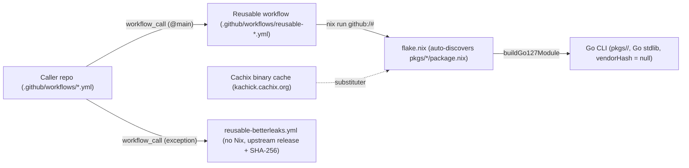
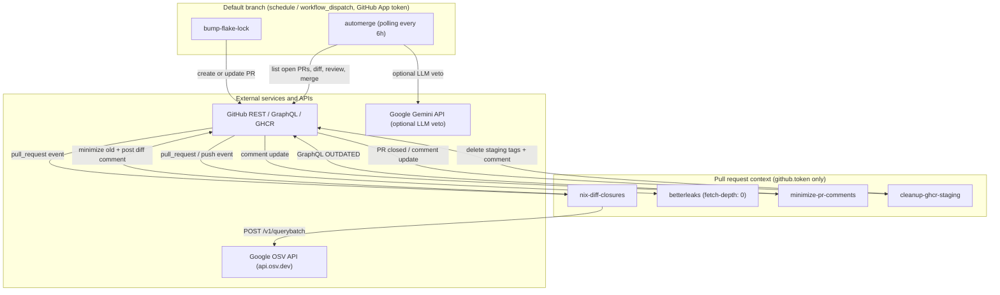
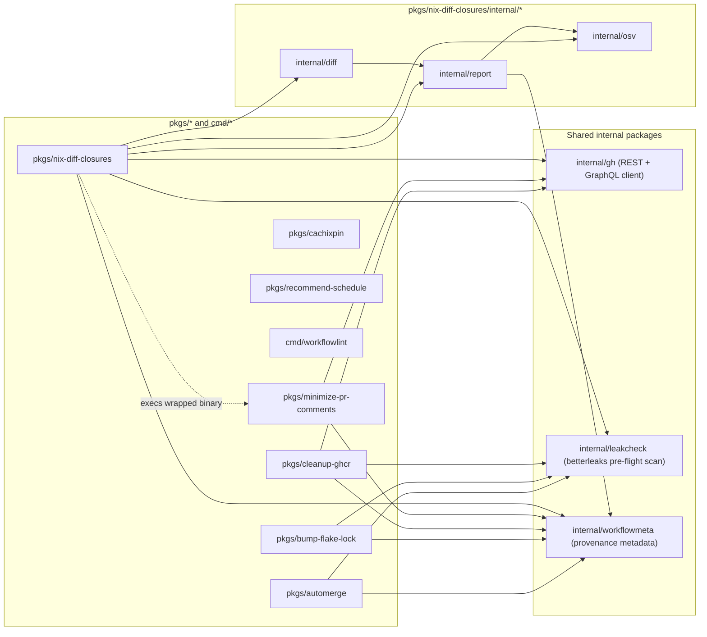

# Architecture

Overview of how caller repositories, reusable workflows, Nix packages, and Go code fit together.
See [NOTES.md](../NOTES.md) for the security principles and trade-offs behind these choices.

## Caller to Runner Execution Model

Caller repositories invoke reusable workflows via `workflow_call`.
Each workflow resolves its own commit SHA (`job.workflow_repository` and `job.workflow_sha`) and runs the matching Go CLI via `nix run`, except `reusable-betterleaks.yml` which downloads the upstream binary directly.

## Workflow Chain and Trust Boundaries

Secret-bearing jobs (`bump-flake-lock`, `automerge`) run on schedules from the default branch and mint short-lived GitHub App tokens.
Pull request jobs (`nix-diff-closures`, `betterleaks`, `cleanup-ghcr-staging`, `minimize-pr-comments`) use only `github.token` with minimal permissions.

## Go Package Dependencies

All CLI tools share one `go.mod` with zero third-party Go modules.
Packages that write text to GitHub PRs or commits pass outgoing payloads through `internal/leakcheck` (`betterleaks`) before sending them.

## Package-Level Diagrams

Each workflow package documents its own control flow and guardrails:

- [automerge](../pkgs/automerge/README.md)
- [betterleaks](../pkgs/betterleaks/README.md)
- [bump-flake-lock](../pkgs/bump-flake-lock/README.md)
- [cleanup-ghcr](../pkgs/cleanup-ghcr/README.md)
- [minimize-pr-comments](../pkgs/minimize-pr-comments/README.md)
- [nix-diff-closures](../pkgs/nix-diff-closures/README.md)
