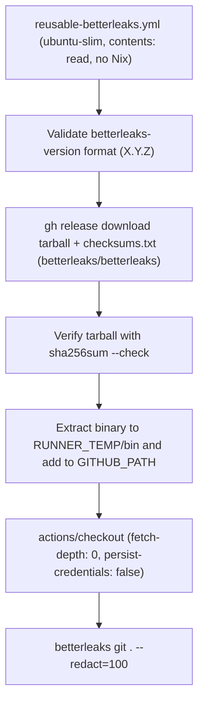

# betterleaks

Scan secrets across git repository history using upstream betterleaks binary.

## Flow



## Usage

```yaml
jobs:
  betterleaks:
    uses: kachick/workflows/.github/workflows/reusable-betterleaks.yml@main
    with:
      betterleaks-version: '1.10.1' # optional
      config-path: '.betterleaks.toml' # optional
```

## Design Decisions & Trade-offs

### Why a standalone reusable workflow instead of repository task runners

- **Avoid unnecessary full clone overhead**:
  - Scanning git commit history (`betterleaks git .`) requires the complete commit history (`fetch-depth: 0`).
  - If betterleaks ran inside caller repository task runners (like `Taskfile.yml` alongside general lint or test tasks), it would force `fetch-depth: 0` on all standard CI jobs.
  - On the other hand, using default shallow clones (`fetch-depth: 1`) by accident would silently miss historical secret leaks.
  - Isolating betterleaks into a dedicated reusable workflow scopes `fetch-depth: 0` strictly to the secret scan job, keeping general CI jobs fast and shallow.
  - Early detection (fail-fast) is no longer a primary driver: workflow runs take only 1-2 minutes anyway. Separating checkout depth and preventing missed scans are the real reasons.

### Why decouple from caller repository flake inputs

- **Catch new leak patterns faster**:
  - Running betterleaks via this reusable workflow intentionally decouples the tool version from each caller repository's `flake.lock`.
  - Caller repository flakes typically update only once a month (for example, via `bump-flake-lock`), while secret detection rules update more frequently upstream.
  - For secret scanning, using newer releases to avoid missing newly added secret patterns is a more important security trade-off than strictly pinning reproducible tool behavior to older flake inputs.
  - Trade-off: Upstream releases sign `checksums.txt` with `cosign` blob bundles rather than GitHub SLSA attestations, so this workflow verifies SHA-256 checksums without pulling in third-party `cosign` installer actions outside the allowed action owners (`kachick/`, `actions/`, `NixOS/`).
