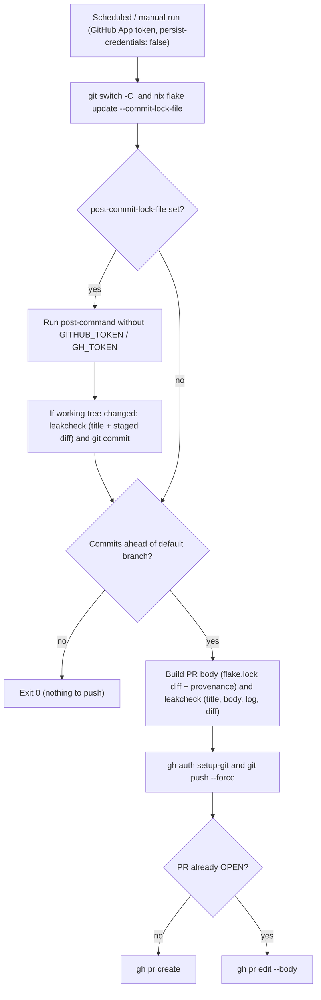

# bump-flake-lock

Update `flake.lock` and create a pull request with GitHub App.

Optionally runs a command after `flake.lock` is updated (for example, to update related CI dependencies) and commits the generated changes before opening the pull request.

## Flow



## Usage

### Reusable Workflow

```yaml
name: Bump Dependencies

permissions:
  contents: read

on:
  schedule:
    # Run once a month on the 1st with distributed hour and minute
    - cron: '17 3 1 * *'
  workflow_dispatch:

jobs:
  bump:
    uses: kachick/workflows/.github/workflows/reusable-bump-flake-lock.yml@main
    with:
      app-id: ${{ vars.APP_ID }}
      # Optional: run custom package to update related files
      post-commit-lock-file: nix run .#update-deps
      post-commit-lock-file-title: 'Sync CI dependencies with nixpkgs'
    secrets:
      APP_PRIVATE_KEY: ${{ secrets.APP_PRIVATE_KEY }}
```

### Tips: Distribute Schedules Across Repositories

See [Distribute Schedules Across Repositories](../../docs/onboarding.md#distribute-schedules-across-repositories) in the onboarding guide for recommended schedule rules and helper scripts.

### CLI

```console
nix run github:kachick/workflows#bump-flake-lock -- --help
```
