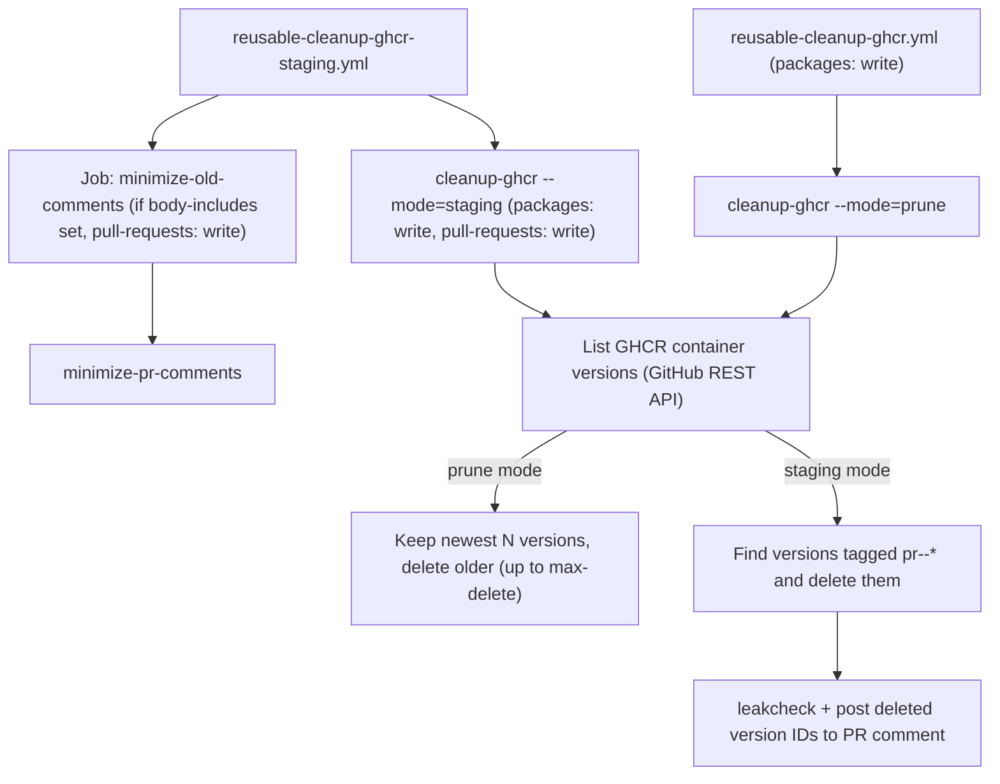

# cleanup-ghcr

Prune old GHCR container package versions or remove temporary PR staging versions.

## Flow



## Usage

### Prune Old Versions (`reusable-cleanup-ghcr.yml`)

```yaml
jobs:
  cleanup:
    uses: kachick/workflows/.github/workflows/reusable-cleanup-ghcr.yml@main
    with:
      package-name: 'home'
      keep-latest-items: 50
```

### Remove PR Staging Versions (`reusable-cleanup-ghcr-staging.yml`)

```yaml
jobs:
  cleanup-staging:
    uses: kachick/workflows/.github/workflows/reusable-cleanup-ghcr-staging.yml@main
    with:
      package-name: 'home'
      pr-number: ${{ github.event.pull_request.number }}
      body-includes: 'staging-deploy-comment' # optional
```

### CLI

```console
nix run github:kachick/workflows#cleanup-ghcr -- --help
```
