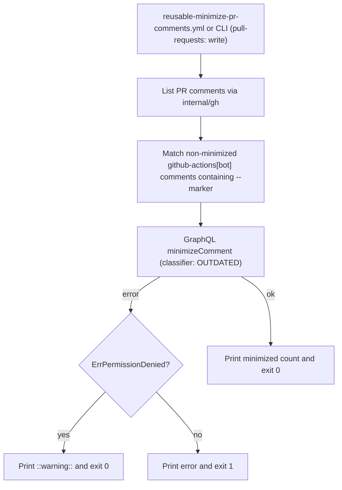

# minimize-pr-comments

Minimize outdated bot comments matching pattern on a pull request.

## Flow



## Features

- **Match substring markers**:
  Finds comments made by `github-actions[bot]` matching a specific pattern.
- **GraphQL minimization**:
  Marks matching comments as `OUTDATED` using GitHub GraphQL API.
- **Graceful permission fallback**:
  Warns and continues cleanly when the token lacks pull request write permissions.
- **Zero third-party dependencies**:
  Implemented in pure Go standard library.

## Usage

### Reusable Workflow

```yaml
jobs:
  minimize:
    uses: kachick/workflows/.github/workflows/reusable-minimize-pr-comments.yml@main
    with:
      pr-number: ${{ github.event.pull_request.number }}
      body-includes: '<!-- comment-marker -->'
```

### CLI

Set `GITHUB_TOKEN` (or `GH_TOKEN`) or pass `--token`:

```console
nix run github:kachick/workflows#minimize-pr-comments -- \
  --owner="<owner>" \
  --repo="<repo>" \
  --pr=<pr-number> \
  --marker="<substring>"
```
